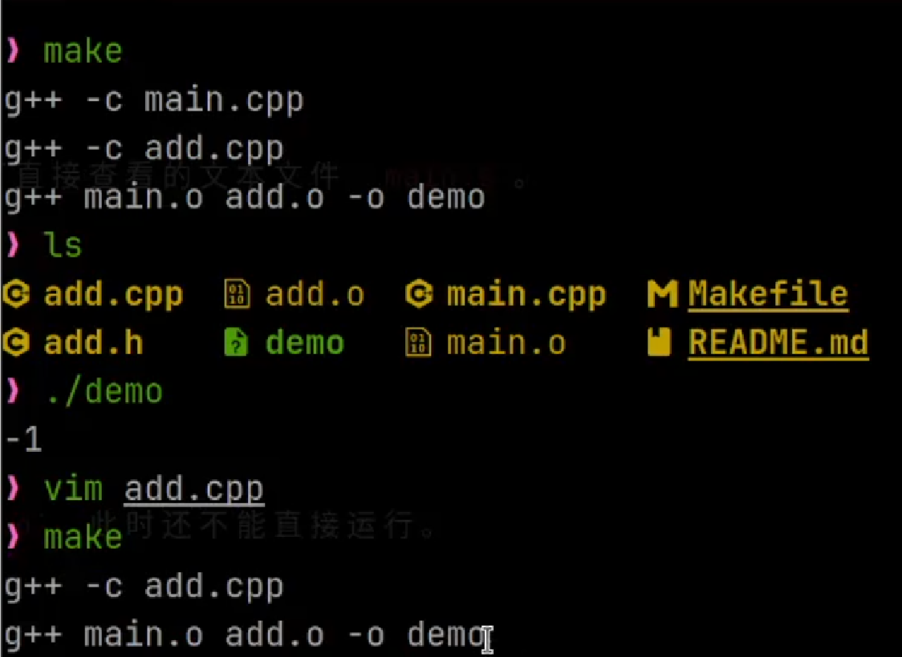
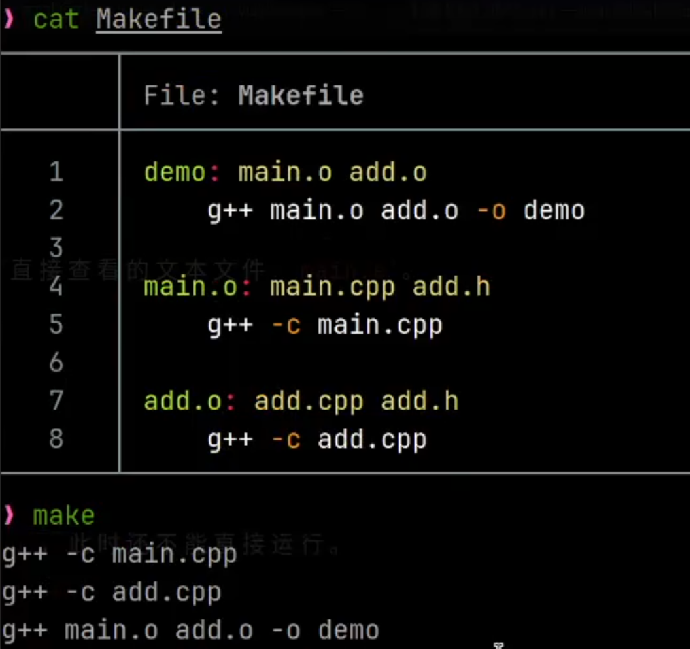

# 27赛季控制视觉招新培训第二课笔记


- 课程内容：CMake、catkin 与大模型使用入门
- 学习目标：理解源代码如何变成程序，以及 CMake 和 catkin 分别解决什么问题
- 时间：2026-10-22


一句话主线：C++ 源代码 → g++ 编译链接 → Makefile 自动构建→ CMake 生成构建文件 → catkin 管理 ROS 功能包

---

##  从源代码到可执行程序


1. 预处理
2. 编译
3. 汇编
4. 链接

步骤：hello.cpp --预处理器（cpp）--> hello.i --编译器（ccl）--> hello.s --汇编器（as）--> hello.o --链接器（ld）--> hello

```bash
g++ -S main.i -o main.s
```

- g++:C++编译器
- -S：告诉编译器只进行编译，生成汇编代码
- main.i：输入的文件，通常是经过预处理的C++代码
- -o：output，指定汇编出来的文件叫什么名字，并把输出的结果保存到后面的文件里面
- main.s：output结果保存到这个文件中（.s是汇编代码文件的后缀）

通过链接实现文件的增量更改，在有多个源代码的时候有较好的体现

课堂中，用main.cpp和add.cpp两个文件进行演示，main.cpp中包含了add.h这个头文件，调用了add函数，而add函数是在add.cpp里面写的，想要编译出来就需要同时处理两个文件，通过

```bash
g++ main.cpp add.cpp -o demo
```

这条命令自动完成两个源文件的预处理、编译、汇编和链接，生成一个demo文件，这个demo就是可执行程序

流程图：
```text
main.cpp -> main.i -> main.s -> main.o ————|
                                           |-->demo
add.cpp -> add.i -> add.s -> add.o  ———————|
```

也可以分别先把两个.cpp文件转换为.o文件再链接在一起，即

```bash
g++ -c main.cpp
g++ -c add.cpp
g++ main.o add.o -o demo
./demo
```

两种方法看起来好像差不多，但第一种方法中`g++ main.cpp add.cpp -o demo` 这条指令会把main.cpp和add.cpp全部重新编译一遍，但其实main.cpp没有更改，没有编译的必要，所以`g++ main.cpp add.cpp -o demo`这条指令会浪费时间和算力，这时我们可以单独对被更改的add.cpp文件进行构建，再进行链接，即

```bash
g++ -c add.cpp
g++ main.o add.o -o demo
./demo
```

这样就可以了，实现了增量构建，提高了编译效率

## Makefile


我们在同一个文件夹里写好Makefile，内容包含（ ），声明demo由什么链接而成，构建的指令，以及main.o、add.o的构建
完成Makefile后我们只需在终端输入`make`，再跑demo文件即可运行程序

当add.cpp被更改后，我们在终端输入`make`，发现没有重新编译main.cpp，只重新编译了add.cpp，这样就实现了增量构建



但是，我们还是要提前在makefile里面写好指令，当文件越来越多时，更改的地方也越来越多，还是很麻烦，怎么办？这时候就需要用到CMake这个工具了


## Cmake

### 为什么需要CMake

1. 随着文件的增加，我们需要维护的Makefile规则会越来越多，单纯考写Makefile也会变得不方便
2. 单纯考Makefile来维护项目的构建做不到灵活地跨平台，而Cmake解决了这个问题

### 使用CMake的好处

1. CMake是一种过程式语言，是一个跨平台的编译工具，可以用简单的语句来描述**所有**平台的编译过程。它能够产生标准的建构档makefile或project文件
2. 我们使用CMake通过编译简单的配置文件去生成本地的Makefile，这个配置是独立运行平台和服务器的，不管在什么平台用什么编译器，Cmake都可以生成对应的makefile。

### CMake的基本用法

先写一个 `CMakeLists.txt`：

```cmake
cmake_minimum_required(VERSION 3.16)
project(add_demo LANGUAGES CXX)

add_executable(demo
    main.cpp
    add.cpp
)
```

各条指令的作用：

- `cmake_minimum_required`：指定最低需要的 CMake 版本，这里最低版本号是3.16。
- `project`：指定项目名称和使用的语言。
- `add_executable`：生成名为 `demo` 的可执行程序，并指定它需要的源文件。

然后在项目目录执行：

```bash
cmake -S . -B build
cmake --build build
```

- `cmake -S . -B build`：读取当前目录的 `CMakeLists.txt`，在 `build/` 中生成构建文件。
- `cmake --build build`：执行 `build/` 中的构建文件，真正编译并链接程序。

CMake 不直接代替 g++ 编译代码。它先根据 `CMakeLists.txt` 生成构建规则，再由 make、ninja 等工具调用编译器完成构建。


## catkin

catkin是ROS1使用的构建系统，比CMake更高一层，增加了功能包管理、依赖处理和构建顺序控制。它不是一种新的编译器，也不会代替g++ 或 CMake。

> catkin并不是新的编译器，也不能代替g++和CMake

课上创建的catkin工作空间：

```text
catkin_ws/
├── src/     # 存放 ROS 功能包和源代码
├── build/   # 构建产生的中间文件
└── devel/   # 开发阶段的程序、库和环境脚本
```

- `src/`：主要编辑的功能包和源代码。
- `build/`：编译过程中的中间文件，平时基本不用管。
- `devel/`：开发阶段生成的可执行文件、库和环境脚本。

### 创建 catkin 工作空间

先检查 catkin 是否可以使用：

```bash
catkin --help
```

课堂使用了 `catkin build`。这套命令通常来自 `catkin_tools`，因此初始化需要使用 `catkin init`：

```bash
mkdir -p ~/catkin_ws/src
cd ~/catkin_ws
catkin init
catkin build
```

如果使用的是传统的 `catkin_make`，则要换成另一套流程：

```bash
mkdir -p ~/catkin_ws/src
cd ~/catkin_ws/src
catkin_init_workspace
cd ~/catkin_ws
catkin_make
```

构建后会生成 `build/` 和 `devel/`。

这两套流程要分开使用，不能把 `catkin_init_workspace` 和 `catkin build` 混在一起。我目前采用课堂演示的 `catkin build` 流程。

### 创建 ROS 功能包

进入工作空间的 `src/`：

```bash
cd ~/catkin_ws/src
```

课堂中创建的是 `test_pkg`，并指定它的依赖：

```bash
catkin_create_pkg test_pkg std_msgs rospy roscpp
```

各种参数含义：

```text
catkin_create_pkg       创建功能包
test_pkg                功能包名称
std_msgs rospy roscpp   功能包依赖
```

执行后会生成一个功能包目录，其中最重要的两个文件是：

- `CMakeLists.txt`：描述怎样编译功能包、生成哪些目标、依赖哪些库；
- `package.xml`：描述功能包名称、版本、作者和依赖关系。

> `catkin_create_pkg` 会按照包名和依赖，自动生成这两个文件的基础模板。

功能包中其他常见的目录还有：

- `src/`：C++ 源文件；
- `include/`：头文件；
- `launch/`：启动多个 ROS 节点；
- `msg/`、`srv/`、`action/`：ROS 消息、服务和动作定义；
- `urdf/`、`config/`：机器人模型和参数文件。

###  构建功能包

先回到工作空间根目录：

```bash
cd ~/catkin_ws
catkin build
```

catkin 会找到 `src/` 中的功能包，读取然后调用CMake生成并执行构建过程。

构建完成后加载工作空间环境：

```bash
source devel/setup.bash
```

新开一个终端后通常需要重新执行这句，ROS 才能找到当前工作空间中的包。
（终于大概搞清楚catkin了……（我上面的理解应该没错吧…））


## 大模型使用入门


### 大模型是什么
大模型(LLM——Large Language Model)会根据前面的内容预测后面最可能出现的内容。

就比如：

```text
C++ 源文件需要经过预处理、编译、汇编和
```

它很可能生成`链接`。生成这个词后，再把它放回上下文继续生成。

所以大模型擅长解释、总结和写代码。

但是，不能保证说的都是真的。（比如某神秘短发红围巾模型）

它可能编出不存在的函数或命令。代码能生成，不代表能编译；能编译，也不代表逻辑正确。

上下文窗口就是模型一次能处理的长度。塞太多无关内容会干扰回答，所以我们需要提供的是必要的信息，不应提供冗余信息

### Agent 是什么

Agent 把大模型和工具连接起来，让它能读文件、改文件、运行命令和查看结果。

它的工作过程大致是：理解目标-> 决定下一步 -> 调用工具 -> 读取结果 -> 继续处理 -> 检查是否完成。

简单来说就是：大模型像`大脑`，负责分析；Agent 像`工具和手脚`，负责执行。

Agent 权限更大，也可能误删文件、覆盖代码或上传不该上传的内容。

不过使用时要注意：
1. 只给它需要访问的目录，不要给密码和密钥。
2. 改代码前先提交 Git，修改后检查内容，重要代码还要实际运行测试。

### 用大模型帮助学习
课堂上讲了四种方法：

1. 找资料并要求来源 —— 让 AI 给出链接，再自己打开核对。
2. 告诉它自己的基础 —— 先说学过什么、哪里不懂，再让它设计解释顺序。
3. 自己讲一遍让它检查 —— 用自己的话复述，再让 AI 指出错误和遗漏。
4. 让它出练习题 —— 先不要答案，自己做完再检查。

一种比较有效的学习顺序是：自己先想 → 看资料或问 AI → 自己复述 → 让 AI 挑错 → 查文档或实际运行 → 记录修正后的理解。

> 注意：AI 只能加快理解和试错。看懂了 AI 的解释，不代表自己已经会做。

### 用大模型帮助开发

向AI提需求不能只说“帮我写一下”，至少要说清楚：

- 目标是什么；
- 当前项目是什么情况；
- 哪些东西不能改；
- 怎样才算完成。

可以使用这个模板：

```text
清楚说明目标：
提供必要上下文：
明确重要约束：
规定验证标准：
```

比如做 CMake 项目时，可以说明源文件位置、最低版本、不能修改哪个接口，以及构建成功后程序要输出什么。

目标和验收标准清楚后，可以多让 Agent 自己读代码和决定步骤，不必每一步都规定得很细。

> 让 AI 修改代码前，最好先提交 Git。这样能看清改动，不满意也可以恢复。
> 此过程应允许Agent自主探索，同时要避免过度规定执行步骤

### Skill 和 AGENTS.md

- **Skill**：把一类任务的步骤、资料、模板或脚本打包起来，重复使用,用于指导Agent完成特定类型的任务。
- **AGENTS.md**：类似于`README.md`这种给人看的项目说明书，`AGENTS.md`是给 AI 看的项目说明书，写常用命令、开发规范和验证要求。

简单理解：**Skills** 像通用工作手册，*AGENTS.md* 像这个项目自己的规则。

AGENTS.md 不用很长，重点写 AI 只看代码不容易知道的内容就行。

### 负责任地使用

AI 写代码很快，但最终调试机器人的还是自己。

对团队负责，就是要理解关键逻辑、检查修改内容并完成测试。

对自己负责，不要让 AI 代替自己思考。可以让它整理、解释和检查，但要保留自己的尝试、疑问和判断。

看到 AI 的回答时，至少检查：

- 来源可靠吗？
- 和当前版本一致吗？
- 自己能讲清楚吗？
- 代码实际运行过吗？

小结：AI 能帮我少走一些弯路，但最后还是要自己理解、动手和验证。

### 一次与AI交互的例子

我问的问题：CMake那里我不是很懂，你帮我解释一下
AI 最初怎么解释： Makefile 是构建说明书，make 按说明书调用编译器，而 CMake 根据 CMakeLists.txt 生成适合当前平台的 Makefile 等构建文件，本身不直接编译。
我哪里没理解：没理清 Makefile、CMake 和编译器各自负责什么，也不明白为什么配置后还要再执行构建。
我怎样查证或运行验证：对照课件和录屏，并用一个包含两个源文件的最小项目运行配置、构建和程序，程序输出 3，再次构建也没有重复编译。
最后修正后的理解：CMakeLists.txt 描述目标和源码，CMake 负责生成构建文件，构建命令再调用 make 等工具完成编译和链接，而 catkin 在 CMake 之上管理 ROS 功能包。

---


## 补充资料笔记

###  程序详细编译过程

来源：[知乎文章](https://zhuanlan.zhihu.com/p/476697014)

这篇文章介绍了 C/C++ 程序从源代码到可执行文件的四个阶段：

```text
源代码 -> 预处理 -> 编译 -> 汇编 -> 链接 -> 可执行文件
```

- 预处理：展开头文件和宏，处理条件编译，删除注释；
- 编译：分析并优化代码，生成汇编代码；
- 汇编：把汇编代码转换为机器指令，生成 `.o` 目标文件；
- 链接：合并多个目标文件和库，处理函数、变量等符号引用。

`.o` 已经是二进制文件，但可能还需要其他目标文件或库，所以不能直接当作完整程序运行。

链接支持分离编译。修改 `add.cpp` 后，只重新生成 `add.o`，再和原来的 `main.o` 链接，不必重新编译没有变化的文件。

平时使用 `g++ main.cpp -o demo` 看似一步完成，实际上是编译器自动执行了上面四个阶段。

> 原文非常详细，为使笔记简洁这里不多介绍。OwO

### CMake 基础


来源：[菜鸟教程 CMake](https://www.runoob.com/cmake/cmake-basic.html)

CMake 是跨平台的构建系统生成器。它读取 `CMakeLists.txt`，再为当前环境生成 Makefile 文件。

常见指令：

```cmake
cmake_minimum_required(VERSION 3.16)
project(MyProject LANGUAGES CXX)
add_executable(demo main.cpp)
target_link_libraries(demo PRIVATE MyLib)
```
- `cmake_minimum_required(VERSION 3.16)`: 最低版本需求：3.16;
- `add_executable`：生成可执行程序;
- `add_library`：生成静态库或动态库；
- `target_link_libraries`：给目标链接库；
- `target_include_directories`：设置头文件路径；
- `find_package`：查找项目依赖。

基本构建流程：

```bash
cmake -S . -B build
cmake --build build
```

第一条命令用来生成构建文件，第二条命令才真正编译和链接。
> 注：CMake 不会代替 g++ 等编译器。

### The Emperor Has No Clothes

来源：[The Emperor Has No Clothes](https://www.mihaileric.com/The-Emperor-Has-No-Clothes/)

这篇文章用约 200 行 Python 实现了一个简单的编程 Agent，说明 AI 编程工具的核心并不神秘。

流程如下：

- 用户提出任务
- 大模型决定调用哪个工具
- Agent 在本地执行工具
- 把结果返回大模型
- 大模型继续处理或结束任务


大模型本身不能直接读写文件，它只输出工具调用请求，真正执行的是 Agent 软件。

文章中的最小 Agent 提供了读取文件、列出目录和修改文件三个工具，并介绍了工具注册、工具说明、调用解析和执行结果的反馈。

总结：大模型负责分析和生成，Agent 负责访问外部环境。


### ROS catkin Tutorials


来源：[ROS Wiki catkin Tutorials](https://wiki.ros.org/catkin/Tutorials)

本文介绍了怎样创建 catkin 工作空间、ROS 功能包并完成构建。

```text
catkin_ws/
|——src/     # 源码和功能包
|—— build/   # 构建中间文件
|—— devel/   # 开发阶段的程序和运行环境
```

传统教程使用以下流程：

```bash
mkdir -p ~/catkin_ws/src
cd ~/catkin_ws
catkin_make
source devel/setup.bash
```

创建功能包：

```bash
cd ~/catkin_ws/src
catkin_create_pkg test_pkg std_msgs rospy roscpp
```

一个 catkin 功能包至少要有：

- `CMakeLists.txt`：描述怎样构建功能包；
- `package.xml`：记录包名、作者、版本和依赖。

 catkin 通过这两个文件确定包的信息、依赖关系和构建过程，并在 CMake 之上组织多个 ROS 功能包。

课堂演示使用的是 `catkin build`，来自 `catkin_tools`，应配套使用 `catkin init`。这篇官方的教程使用的是 `catkin_make` 流程，两种流程不要混用。
